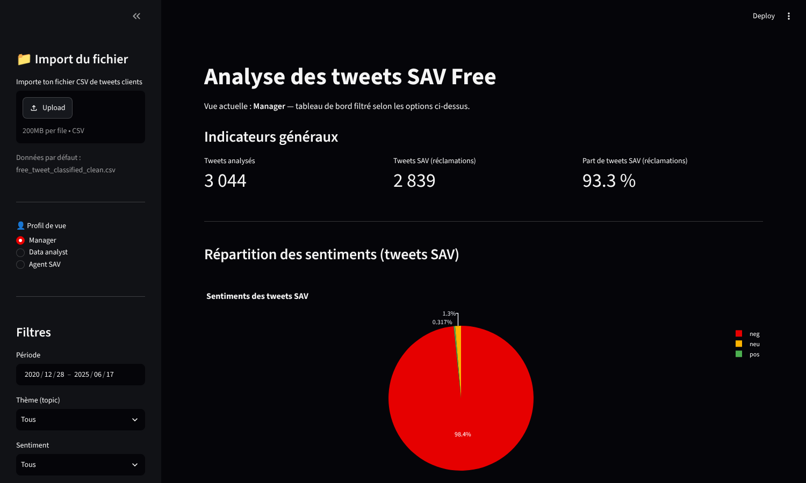
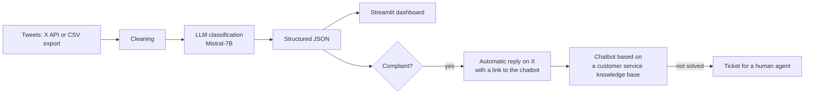
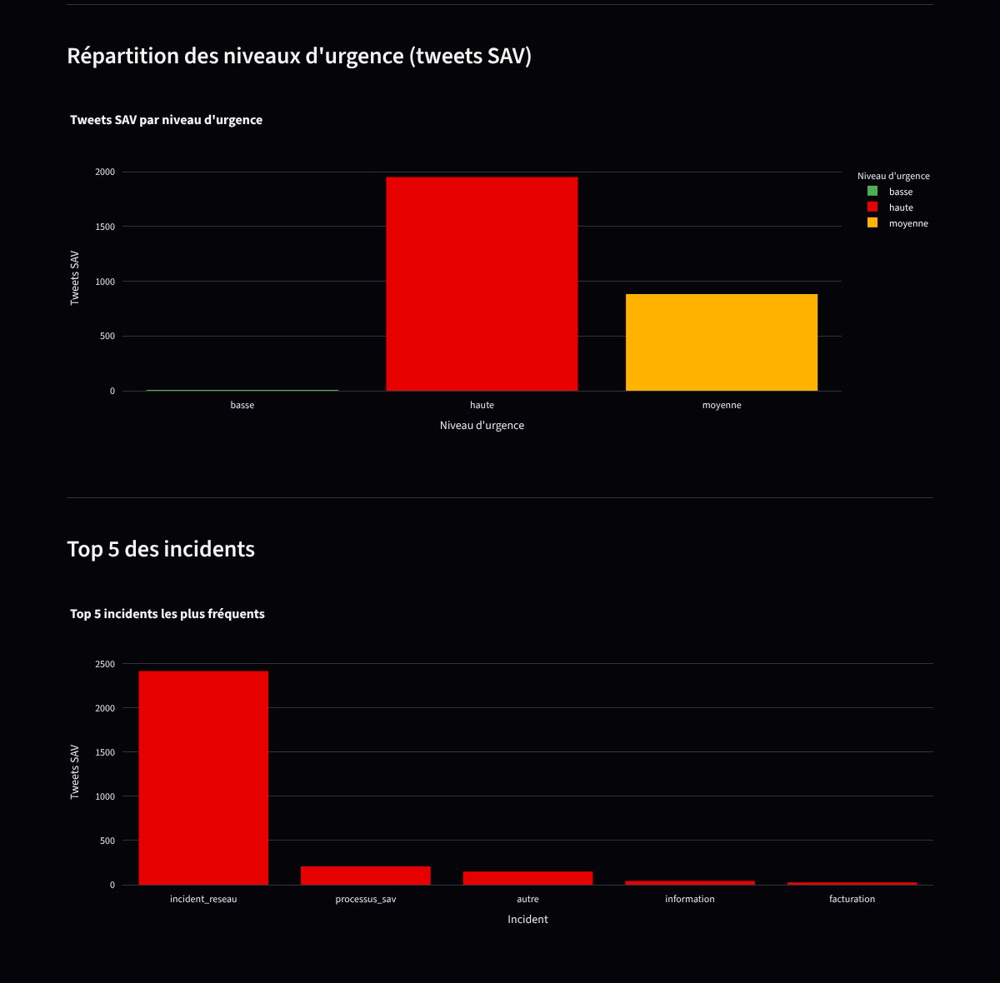
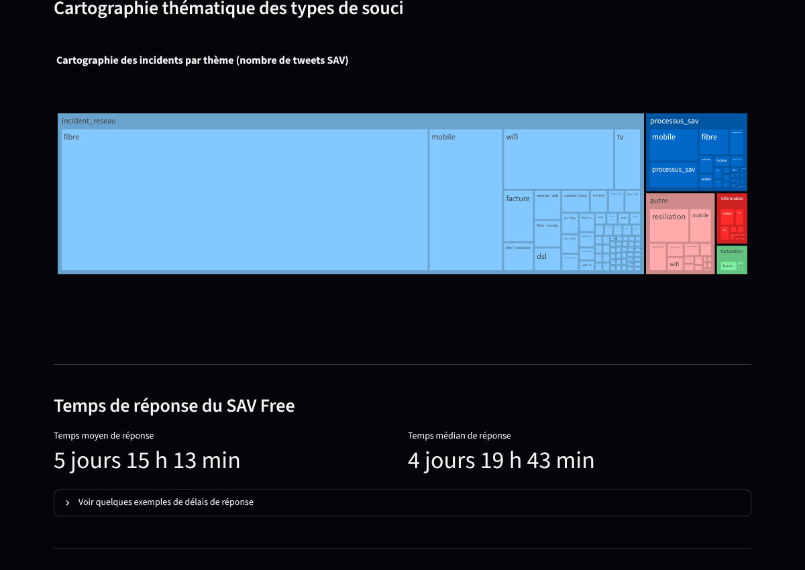
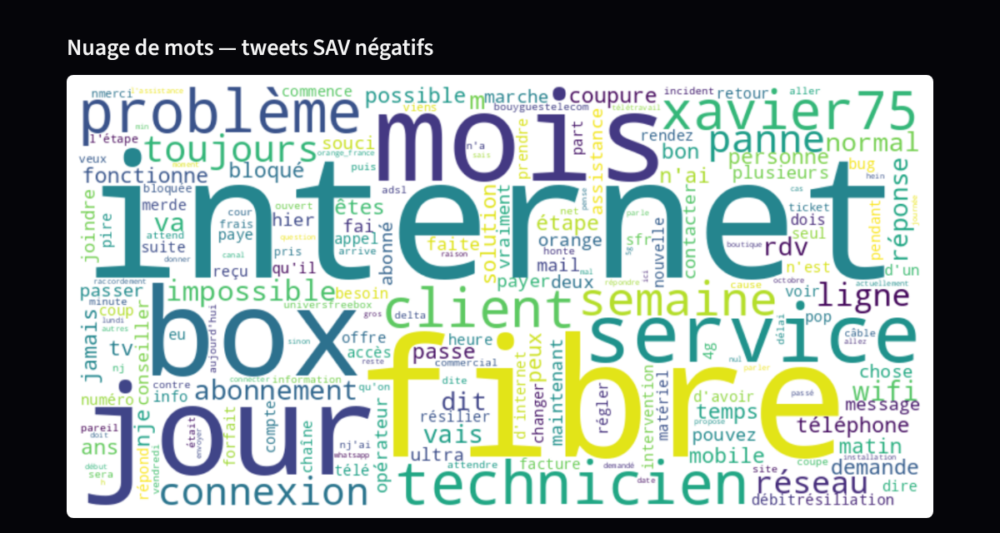

# Classifying Free Mobile customer complaints on X with an LLM

This was our final project for the Master Data & AI at HETIC, from May to November 2025, done in a team of 5 on a Free Mobile use case.

Free's customer service account on X (Twitter) receives a lot of messages, and many customers use it as an emergency channel when their internet or mobile line stops working. When we analysed the data, the average response time was more than 5 days. Our goal was to build a proof of concept that finds the real complaints automatically, understands what they are about and how urgent they are, and sends them to the right place: a chatbot for simple requests, a human agent for the rest.

I was the Business Analyst / Product Owner of the project. On the technical side, I wrote the LLM classification of the whole dataset (notebook and prompt), the Streamlit dashboard and one of the benchmark scripts. The work of the rest of the team is credited at the end of this page.



## The problem in numbers

We worked on 3,044 tweets sent to Free's support account between December 2020 and June 2025.

| | Value |
|---|---|
| Tweets analysed | 3,044 |
| Real customer service complaints | 2,839 (93.3%) |
| High urgency complaints | 68.7% |
| Negative complaints | 98.4% |
| Average response time from Free | 5 days 15 hours |
| Median response time | 4 days 19 hours |

The complaints are mostly about fibre and network outages, SIM cards and billing, and they come in big peaks when there is an outage, often in the evening and at weekends.

## How the solution works



The whole flow is orchestrated with n8n: collecting the tweets, cleaning them, calling the model, storing the results and sending the replies. The model runs through the Mistral API in normal mode, and locally with Ollama as a fallback when the API is down or during traffic peaks.

### 1. Cleaning

The cleaning notebook ([`cleaning/clean.ipynb`](cleaning/clean.ipynb)) removes duplicates, URLs, HTML entities and hashtags, normalises the text and prepares a version of each tweet ready to be sent to the model.

### 2. Classification with the LLM

Each tweet is sent to Mistral-7B with a system prompt and a few annotated examples ([`classification/prompt_tweets_free.txt`](classification/prompt_tweets_free.txt)). The model must answer with a single JSON line:

```json
{"is_claim": 1, "topics": ["fibre"], "sentiment": "neg", "urgence": "haute", "incident": "incident_reseau", "confidence": 0.9}
```

| Field | Values |
|---|---|
| `is_claim` | 1 if the tweet is a real complaint, 0 otherwise |
| `topics` | fibre, DSL, wifi, TV, mobile, billing, activation, cancellation, other (several are possible) |
| `sentiment` | negative, neutral, positive |
| `urgence` | low, medium, high |
| `incident` | network incident, billing, delivery, information request, customer service process, other |
| `confidence` | between 0 and 1 |

Getting a clean JSON for 3,000 tweets took some work. The notebook ([`classification/classification.ipynb`](classification/classification.ipynb)) retries the calls that fail with a growing delay, parses the answer in a tolerant way when the model adds text around the JSON, normalises the labels (accents, upper and lower case) and flags the rows that still fail so they can be checked by hand.

### 3. Choosing the best prompting strategy

To choose how to prompt the model, we annotated 300 tweets by hand, split them in a stratified way and compared 5 strategies on the test set (30 tweets). We measured the quality with scikit-learn (F1 score per class and macro-F1), the latency (median and 95th percentile) and the number of tokens in the prompt.

| Strategy | Macro-F1 | F1 negative / neutral / positive | Prompt tokens |
|---|---|---|---|
| Few-shot, 6 fixed examples | 0.426 | 0.943 / 0.333 / 0.000 | 848 |
| Few-shot, 12 fixed examples | 0.480 | 0.941 / 0.500 / 0.000 | 1,449 |
| Few-shot, 24 fixed examples | 0.542 | 0.960 / 0.667 / 0.000 | 2,667 |
| System prompt + 3 examples | 0.511 | 0.962 / 0.571 / 0.000 | 1,004 |
| Retrieval of the 12 closest examples (MMR) | 0.903 | 0.960 / 0.750 / 1.000 | 1,450 |

What we learned:
- With fixed examples, the model never found the positive tweets. There are only 9 of them out of 300, so they were almost never in the examples.
- Adding more fixed examples helps a bit but makes the prompt much longer and slower.
- Selecting, for each tweet, the 12 most similar annotated examples fixed the problem. The tweets are turned into vectors with Sentence-Transformers (`all-MiniLM-L6-v2`), and Maximal Marginal Relevance (MMR) picks examples that are close to the tweet but not all identical. The macro-F1 went from 0.54 to 0.90 with a prompt shorter than the 24-example version, so we kept this strategy.
- The downside is the latency on a laptop CPU, because of the embeddings. The next steps would be to cache the embeddings, use a FAISS index and serve the model on a GPU.

The test set is small (30 tweets, only 1 positive). These numbers validate the approach for a proof of concept, not a model ready for production.

The scripts and a screenshot of each run are in [`benchmarks/`](benchmarks/).

### 4. Dashboard

The Streamlit dashboard ([`dashboard/app.py`](dashboard/app.py)) is built for 3 profiles: manager, data analyst and customer service agent. It can be filtered by period, topic, sentiment, incident type and urgency, and shows:
- the key figures: number of tweets, share of complaints, share of urgent and negative messages
- the split by sentiment and by urgency
- the most frequent incidents
- the volume of messages per day and per week, to see the outage peaks
- a map of the topics and a word cloud of the complaints
- the response time of the customer service

| Urgency and top incidents | Topics and response time |
|---|---|
|  |  |



## Our recommendations to Free

1. **A chatbot on X** for simple requests such as the status of an outage, restarting the Freebox or checking a line, with a goal of answering in less than an hour instead of 5 days.
2. **Automatic prioritisation** of urgent tweets by the LLM, and routing to the right team.
3. **A "network crisis" team** with longer hours, because outages create big peaks in the evening and at weekends.
4. **A live FAQ** built from the most frequent complaint topics (fibre, SIM, general outages).

## Privacy

The data published here is anonymised with [`scripts/anonymize_data.py`](scripts/anonymize_data.py):
- the tweet IDs are replaced by salted hashes, so the link between a customer tweet and Free's answer still works
- user names, user IDs, profile pictures and URLs are removed
- mentions of private people are replaced by `@user`, while brands and institutions (Free, Orange, Arcep...) are kept
- emails and phone numbers are masked

## Repository structure

```
free-customer-care-llm/
├── cleaning/          cleaning notebook
├── classification/    LLM classification notebook and system prompt
├── benchmarks/        evaluation scripts of the 5 strategies and their results
├── dashboard/         Streamlit app
├── data/              anonymised datasets (raw, cleaned, classified, Free's replies)
├── scripts/           anonymisation script
└── docs/images/       screenshots
```

## Run it

```bash
git clone https://github.com/Yassinech12/free-customer-care-llm.git
cd free-customer-care-llm
pip install -r requirements.txt

# the dashboard loads the anonymised classified dataset by default
streamlit run dashboard/app.py
```

To run the classification again, install [Ollama](https://ollama.com), download the model with `ollama pull mistral`, then open `classification/classification.ipynb`. The benchmark scripts need the annotated split files, which are not included in this repository.

## Tech stack

Python, Pandas, Mistral-7B, Ollama, Sentence-Transformers, scikit-learn, Streamlit, Plotly, n8n, FastAPI. We worked in Scrum with 2-week sprints, and used Trello, GitHub, Notion and Microsoft Teams.

## The team

| Member | Role | Main work |
|---|---|---|
| Mohamed Yassine CHARIT | Business Analyst / Product Owner | product vision and backlog, LLM classification of the full dataset (notebook and prompt), Streamlit dashboard, system prompt + 3 examples benchmark, data analysis and recommendations |
| Mohammed Taha OUAAZZI | Project Manager | planning, coordination, Scrum ceremonies |
| Kouassi Anderson EHOUSSOU | Solution Architect | technical architecture, Mistral-7B integration |
| Houssam NAJIH | AI and Data | data collection and cleaning, FastAPI, n8n integration |
| Hamza AJERMOUN | Lead Developer | few-shot and retrieval benchmarks, infrastructure |

Original team repository: [Houssam-Najih/X_Automation_Project](https://github.com/Houssam-Najih/X_Automation_Project)

---

Yassine CHARIT · [LinkedIn](https://www.linkedin.com/in/yassine-charit/) · [GitHub](https://github.com/Yassinech12)
